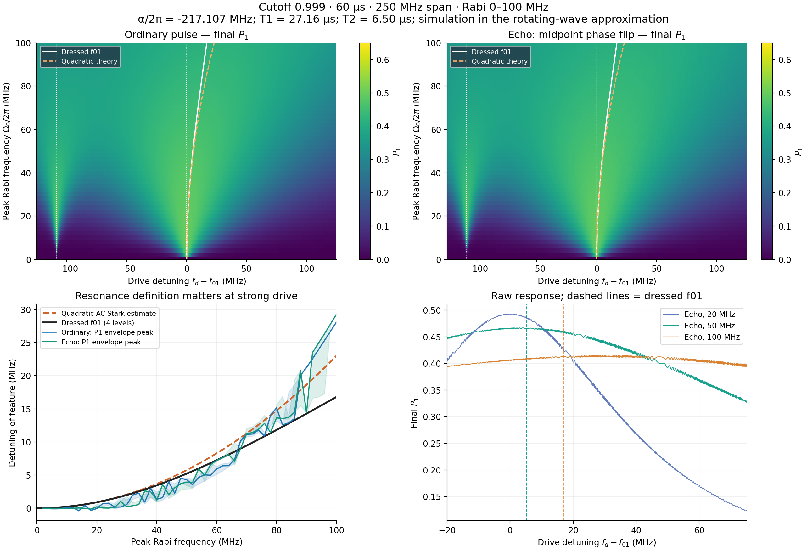

# 60 µs near-square spectroscopy: cutoff 0.999

## Model and sweep

- Duration: 60 µs; root-Lorentzian order 0.5; endpoint/peak = 0.999.
- Both ordinary and midpoint-pi-flipped echo pulses; no DRAG, Stark compensation, or endpoint subtraction.
- 51 peak Rabi amplitudes, 0–100 MHz; 501 broad detunings, −125 to +125 MHz.
- Additional 951 detunings from −20 to +75 MHz at 0.1 MHz spacing resolve the f01 region.
- Four-level Duffing transmon, Lindblad relaxation and number-operator pure dephasing; initial ground state.
- Current SimulationConfig values: alpha/2pi = -217.106667324 MHz,
  T1 = 27.155802304 µs, T2 = 6.497862158 µs, Tphi = 7.380918168 µs.
- f01 is the zero of the frequency axis. Add these shifts to your device's bare f01 to obtain an absolute frequency.
- Rotating-wave model: no Bloch–Siegert shift, resonator/readout response, hardware filtering, or noise realizations.

## What is being called resonance?

The solid dark curve is the drive detuning that minimizes the upper-two dressed-state
gap of H/h = −delta n + (alpha/2pi)n(n−1)/2 + A f(t)(a+a†)/2,
time averaged over the envelope. This follows the f01 avoided crossing. It is
independent of the sign flip and is not the largest point in a population spectrum.

The blue/green curves are operational maxima of final P1 in the f01 window,
after local refinement on a 0.02 MHz grid and Gaussian smoothing with sigma = 0.5 MHz.
Shading is the range from sigma
0.25 to 1 MHz, a smoothing-sensitivity range, not a statistical confidence interval.
These maxima include saturation, leakage, dissipation and finite-pulse effects;
they must not be identified automatically with the Hamiltonian AC Stark shift.
There is no measurable resonance at zero drive; operational centers there are NaN.
The broad overview samples do not resolve every finite-pulse fringe.

## Analytical comparison

With A = Omega0/2pi in MHz and alpha_f = alpha/2pi,

    delta_f_Stark ≈ −A² <f²> / (2 alpha_f)
    <f²> = atan(sqrt(c^(-2)−1)) / sqrt(c^(-2)−1) = 0.999333133

The sign is positive because alpha_f is negative. Flipping the drive phase
does not change f². At 100 MHz, A/|alpha_f| = 0.461,
so the weak-drive quadratic expression is no longer quantitatively accurate.
The comparison concerns a single near-resonant drive, not a separate off-resonant Stark tone.
The local derivation is in paper/appendices/K_ac_stark_shift.tex. Background on
multilevel dressing: [Multi-level quantum noise spectroscopy](https://pmc.ncbi.nlm.nih.gov/articles/PMC7878521/).

| Rabi (MHz) | Dressed f01 shift (MHz) | Quadratic (MHz) | Ordinary P1 peak (MHz) | Echo P1 peak (MHz) |
|---:|---:|---:|---:|---:|
| 20 | 0.9054 | 0.9206 | -0.0482 | 0.2079 |
| 50 | 5.2236 | 5.7537 | 4.2996 | 3.9385 |
| 80 | 11.8186 | 14.7295 | 15.1385 | 13.6504 |
| 100 | 16.7996 | 23.0148 | 28.1070 | 29.2921 |

The bare two-photon f02/2 feature lies at -108.5533 MHz,
inside the requested span. It is not f01; at high amplitude its position and line shape also change.

## Validation and files

Full Lindblad matrix exponentials on 64 midpoint segments per half.
Quadrupling the segment count on 27 amplitude/detuning probes changed final
populations by at most 6.25e-06.
Adding a fifth level changed probe P1 by at most
0.00154; the 100 MHz dressed
resonance changed by 0.00129631 MHz.
These are sampled convergence checks, not bounds over the whole map.

- spectroscopy.npz: both protocols, all four populations, broad and fine frequency grids.
- resonance_vs_amplitude.csv / resonance_analysis.npz: analytical, dressed and operational centers.
- refined_peak_spectra.npz / refined_peak_centers.npz: dense local spectra and refined maxima.
- metadata.json: exact config, raw state physicality diagnostics and convergence checks.
- broad_spectroscopy.png / .pdf and state_populations.png: rendered figures.

Reproduce from the repository root:

    .venv/bin/python scripts/make_cutoff_broad_spectroscopy.py --duration-us 60

This is a numerical model result, not a hardware measurement.
