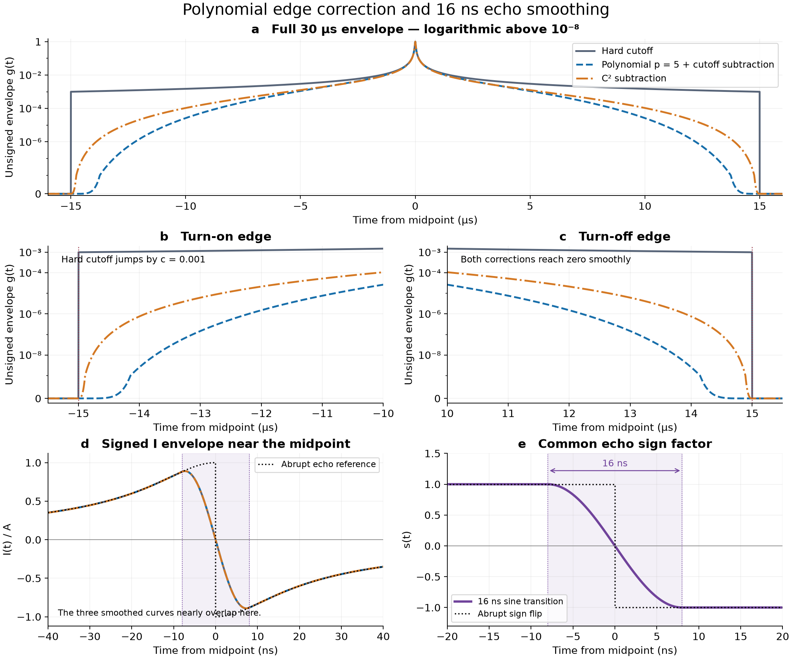
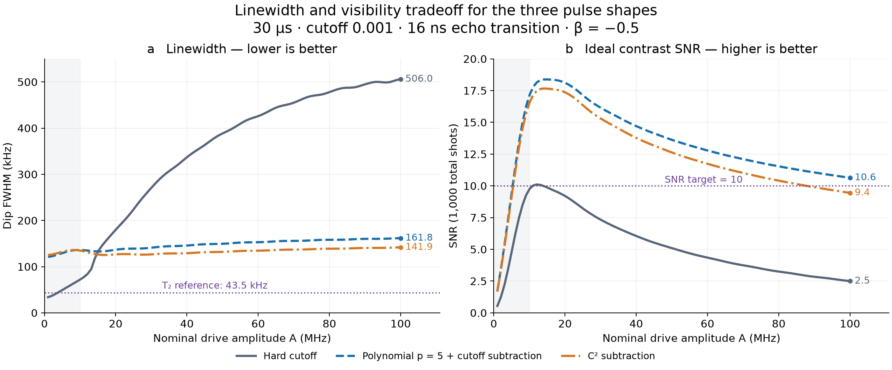
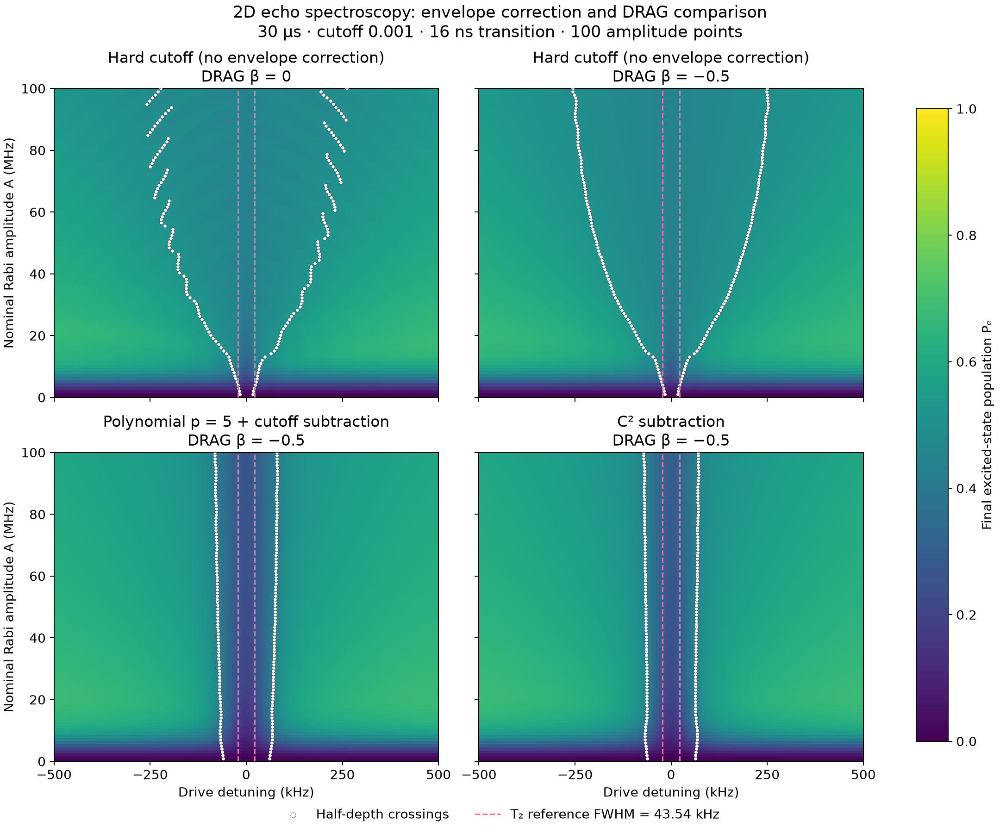

# Polynomial correction and 16 ns echo smoothing

Research note — 11 October 2026; 2D sweep comparison added 13 October 2026

The aim is a narrow echo-spectroscopy dip with useful contrast over a broad
range of drive amplitudes. Two separate modifications make the waveform
smoother: a polynomial correction at the outer edges and a 16 ns sign change
at the midpoint. They can improve amplitude robustness, but they do not by
themselves produce a T2-limited resonance.

## Pulse definition

Take time relative to the pulse midpoint. The unsigned root-Lorentzian is

\[
f(t)=\frac{1}{\sqrt{1+(t/\sigma)^2}}.
\]

For the 30 microsecond pulse, the endpoints are at ±15 microseconds. The
cutoff is the value of the original envelope at those endpoints:

\[
c=f(L/2)=0.001,\qquad
\sigma=\frac{L/2}{\sqrt{c^{-2}-1}}\approx15\,\mathrm{ns}.
\]

Subtracting the cutoff value makes the envelope reach zero at the endpoints.
Multiplying by a polynomial window also softens its approach to zero:

\[
g(t)=\frac{f(t)-c}{1-c}
\left[1-\left(\frac{2t}{L}\right)^2\right]^p,
\qquad |t|<L/2,
\]

with zero drive outside the pulse. Here p controls how strongly the tails
are suppressed; p = 4 and p = 5 were comparison pulses in the recent scans.
The normalization keeps the unsigned envelope at g(0) = 1. It does not
preserve pulse area or renormalize the peak after the echo sign change.

## What C2 subtraction means

C² subtraction is an alternative polynomial correction, rather than the
same operation as multiplying by the window above. It subtracts a polynomial
chosen to make the amplitude, slope, and curvature all vanish at both edges:

\[
g(t_{\mathrm{edge}})=g'(t_{\mathrm{edge}})
=g''(t_{\mathrm{edge}})=0.
\]

In the implemented version, define y = 1 − (2t/L)² and a = 1 − c². Inside
the pulse,

\[
g_{C^2}(t)=
\frac{f(t)-c\left(1+\frac{a}{2}y+\frac{3a^2}{8}y^2\right)}
{1-c\left(1+\frac{a}{2}+\frac{3a^2}{8}\right)}.
\]

Outside the pulse it is zero. In simple terms, the pulse joins the zero-drive
region without a jump in height, slope, or curvature. C² describes the
smoothness of the outer envelope, not the coherence time T2 or the window
power p.

## The 16 ns midpoint transition

The echo reverses the sign of the drive. Instead of an instantaneous jump,
use a sine transition with total duration T = 16 ns:

\[
s(t)=
\begin{cases}
+1, & t<-T/2,\\
-\sin(\pi t/T), & |t|\leq T/2,\\
-1, & t>T/2.
\end{cases}
\qquad I(t)=A\,g(t)s(t).
\]

The signed I envelope therefore moves from positive to negative over
−8 to +8 ns, crossing zero at the midpoint. Its amplitude and first
derivative are continuous. The sine transition still has jumps in its
second derivative at the joins, so the complete echo waveform is not
globally C² merely because its outer envelope is C².

When DRAG is enabled, compute Q from the complete smoothed I envelope:

\[
Q(t)=-\frac{\beta}{2\pi|\alpha|}\frac{dI(t)}{dt},
\qquad
\frac{dI}{dt}=A\left[g'(t)s(t)+g(t)s'(t)\right].
\]

Time is in microseconds and anharmonicity alpha is in MHz. The recent
comparison used alpha = −216 MHz, beta = −0.5, and complex drive I − iQ.
Keep the same 16 ns smoothing for every beta, including beta = 0, when
comparing DRAG strengths. An abrupt echo is a separate reference pulse.

## Waveform comparison



**Figure 1.** Pulse-shape comparison for L = 30 microseconds and c = 0.001.
The polynomial curve uses cutoff subtraction followed by the p = 5 window;
the C² curve uses the separate subtraction formula above. Panel a shows the
unsigned envelopes over the full pulse. Panels b and c resolve both outer
edges: the hard cutoff jumps by 0.001, while the corrected envelopes reach
zero continuously. These envelope axes are logarithmic away from zero, with
a small linear region that allows zero to be shown. Panels d and e show the
signed I envelope and the common 16 ns sign factor. Shading marks −8 to +8 ns.
The three smoothed I curves nearly coincide near the midpoint; the dotted
black curve is a separate abrupt-echo reference. “Hard cutoff” refers to the
outer edges and still uses the same 16 ns midpoint transition in panel d.
These are waveform plots, not simulated population or linewidth results.

[Vector PDF](../../figures/paper/polynomial_echo_note/comparison.pdf) ·
[Waveform arrays](../../figures/paper/polynomial_echo_note/waveforms.npz) ·
[Parameters and provenance](../../figures/paper/polynomial_echo_note/provenance.json) ·
[Figure generator](../../scripts/plot_polynomial_echo_note.py)

## Linewidth and SNR tradeoff



**Figure 2.** The same three pulses as Figure 1, using existing matched
three-level simulations at 100 amplitudes from 0 to 100 MHz. All use
L = 30 microseconds, c = 0.001, the 16 ns echo transition, beta = −0.5,
alpha = −216 MHz, T1 = 51.24 microseconds, and T2 = 7.31 microseconds.
The detuning grid has 201 points over ±0.5 MHz, and the integration step is
0.5 ns. The shaded 0–10 MHz region is outside the primary operating range.
At zero amplitude there is no dip, so FWHM and SNR are undefined and omitted.

| Pulse | FWHM at 100 MHz | Ideal SNR at 100 MHz |
| --- | ---: | ---: |
| Hard cutoff | 506.0 kHz | 2.50 |
| Cutoff-subtracted polynomial, p = 5 | 161.8 kHz | 10.64 |
| C² subtraction | 141.9 kHz | 9.45 |

The hard-cutoff pulse starts with a narrow dip, but it broadens strongly and
loses visibility as amplitude increases. The polynomial pulse maintains
SNR above 10 across the sampled 10–100 MHz range, at the cost of a broader
low-amplitude line. C² subtraction gives a narrower line than p = 5 at high
amplitude, but its SNR falls below 10 before reaching 100 MHz. Neither
correction keeps the high-amplitude linewidth near the 43.5 kHz T2 reference.

FWHM uses the nearest half-depth crossings relative to a linear background
fitted at |detuning| = 0.4–0.5 MHz. SNR assumes 1,000 ideal independent
Bernoulli shots: 500 at the extracted dip center and 250 at each ±0.45 MHz
shoulder. It excludes assignment errors, technical noise, drift, and the
cost of finding the center. These two metrics do not measure extra dips
outside the selected spectral window. A low-amplitude finite-pulse dip can
have a half-depth width below the weak-drive T2 reference without establishing
a useful T2-limited line or an improvement in measurement sensitivity.

[Vector PDF](../../figures/paper/polynomial_echo_note/tradeoff.pdf) ·
[Per-amplitude metrics](../../figures/paper/polynomial_echo_note/tradeoff_metrics.csv) ·
[Population maps](../../figures/paper/polynomial_echo_note/tradeoff_populations.npz) ·
[Parameters and provenance](../../figures/paper/polynomial_echo_note/tradeoff_provenance.json) ·
[Figure generator](../../scripts/plot_polynomial_echo_tradeoff.py)

## Two dimensional sweep comparison

[Open the interactive four-panel figure](../../figures/paper/polynomial_echo_note/sweeps_2d.html).
Its shared slider sets the color-bar maximum from 0.05 to 1 for all four
panels; the minimum stays at zero. Values above the maximum saturate in color.
This changes only the display, not the population values or FWHM markers.



**Figure 3.** Final excited-state population Pe versus drive detuning and
nominal Rabi amplitude. Top left: hard-cutoff root-Lorentzian with beta = 0.
Top right: the same hard-cutoff pulse with beta = −0.5. Bottom left:
cutoff-subtracted polynomial p = 5 with beta = −0.5. Bottom right:
C² subtraction with beta = −0.5. Both hard-cutoff pulses omit cutoff
subtraction and polynomial windowing. All four retain the same
16 ns sine echo transition, including the beta = 0 pulse.

All four maps use 100 amplitude points from 0 to 100 MHz and 201 detunings from
−500 to +500 kHz. Duration, cutoff, coherence times, anharmonicity, and the
0.5 ns integration step match Figure 2. The color scale is shared, from
Pe = 0 to 1, with no normalization of individual amplitude rows. Darker
features indicate lower final excited-state population.

White points mark the left and right half-depth crossings for each amplitude;
their horizontal separation is the FWHM. They are interpolated from each
simulated spectrum using the same linear background at |detuning| = 0.4–0.5 MHz
as Figure 2. They are actual crossings, not a symmetric width drawn around
the dip center. No points are shown at zero amplitude, where there is no dip.

Pink dashed vertical lines at ±21.77 kHz show the half-width positions of the
weak-drive T2 reference centered at zero detuning. Their separation is
1/(pi T2) = 43.54 kHz for T2 = 7.31 microseconds. The lines appear in both
the static and interactive plots and remain fixed when the color scale changes.

Compare the top-right hard-cutoff panel with either lower panel to isolate
the envelope correction at fixed beta = −0.5. Compare the two top panels
to isolate DRAG beta with the envelope unchanged.

[Vector PDF](../../figures/paper/polynomial_echo_note/sweeps_2d.pdf) ·
[Polynomial population map](../../outputs/optimized_echo_tail/polynomial5_full.npz) ·
[C2 population map](../../outputs/optimized_echo_tail/c2_full.npz) ·
[Hard-cutoff beta zero population map](../../outputs/polynomial_echo_note_2d/c0.001_hard_beta0.npz) ·
[Hard-cutoff beta minus 0.5 population map](../../outputs/polynomial_power_30us_scan/c0.001_hard.npz) ·
[Half-depth points and FWHM values](../../figures/paper/polynomial_echo_note/sweeps_2d_fwhm_points.csv) ·
[Parameters and validation](../../figures/paper/polynomial_echo_note/sweeps_2d_provenance.json) ·
[Figure generator](../../scripts/plot_polynomial_echo_2d.py)

## Benefits in simple terms

- **Gentler pulse edges.** The drive turns on and off smoothly instead of
  being cut while its amplitude is nonzero. This reduces the abrupt changes
  that can generate unwanted spectral structure.
- **More stable response with amplitude.** In the polynomial simulations,
  shaping improved the robustness of linewidth and contrast over a wider
  amplitude range. This is a result for the tested pulses, not a guarantee
  for every polynomial order.
- **A well-defined DRAG waveform.** The midpoint transition removes the
  instantaneous I jump. C² outer edges also make Q and its slope approach
  zero smoothly at the endpoints.
- **Fair comparisons.** Holding the envelope and transition time fixed
  makes changes with beta easier to interpret.

## Costs and limitations

- **Stable can still mean broad.** Polynomial shaping suppresses the long
  tails that help form the narrow response. Our scans showed a tradeoff:
  linewidth can stay stable over more amplitudes while remaining broader
  than the narrow low-amplitude dip of an unwindowed reference.
- **The cutoff dependence remains.** Subtraction removes the nonzero
  endpoint value, but duration, core width, and polynomial order still
  affect the dynamics. At fixed L, changing c also changes sigma in this
  parameterization; it is not only a change to the edge treatment.
- **The midpoint smoothing changes the pulse physics.** Passing through
  zero over 16 ns changes the central drive and the interference response.
  A short transition can still generate a substantial Q component because
  its slope is large.
- **Smoothness does not guarantee adiabaticity.** Whether the state follows
  the drive also depends on detuning, amplitude, and the relevant energy
  gaps. Extra dips and drive-induced shifts can remain.
- **Contrast is not measured SNR.** Simulated SNR also depends on the shot
  budget and noise assumptions. Good contrast alone does not establish
  experimental SNR around 10.

For T2 = 7.31 microseconds, the weak-drive Lorentzian reference linewidth is
1/(pi T2) ≈ 43.5 kHz. The polynomial correction and 16 ns transition have
not established a clean dip at that linewidth across 10–100 MHz. Their
demonstrated value is improved waveform smoothness and, for the tested
shapes, improved robustness; linewidth and extra dips must still be checked
in the full simulated spectrum.

## Implementation and simulation records

- [Polynomial window and cutoff subtraction](../../scripts/scan_duration_polynomial.py)
- [C2 subtraction and midpoint transition](../../scripts/optimize_echo_tail.py)
- [Pulse comparison report](../../outputs/optimized_echo_tail/report.html)
- [Full spectrum optimization report](../../outputs/dense_spectrum_optimization/report.html)

This note documents the simulation pulse definitions and their tradeoffs.
It does not report hardware validation.

## Working choice and cutoff/duration sweep — 11 October 2026

Keep the simpler **cutoff subtraction × polynomial window**, with **p = 5**,
as the working pulse. The C² subtraction and optimized spline tails remain
comparison ideas documented above; they are not the pulse selected for this
sweep. Start from **L = 30 microseconds**, the same **16 ns sine transition**,
and corrected DRAG **beta = −0.5**, including both terms in dI/dt. The
quadrature denominator is 2π|alpha| and the complex drive is I − iQ. There is
no additional phenomenological Stark correction or peak/area renormalization.

The reproducible runner is
[scan_polynomial_cutoffs.py](../../scripts/scan_polynomial_cutoffs.py), backed
by [polynomial_echo.py](../../echospec/simulation/polynomial_echo.py).

```bash
# Initial run: 10 log-spaced cutoffs, 10^-5 through 1 inclusive.
.venv/bin/python scripts/scan_polynomial_cutoffs.py --cutoff-count 10 --workers 2

# Next: the requested 50-cutoff map, with the same endpoints.
.venv/bin/python scripts/scan_polynomial_cutoffs.py --cutoff-count 50 --workers 2

# Later: the same cutoff grid at several lengths.
.venv/bin/python scripts/scan_polynomial_cutoffs.py --cutoff-count 50 \
  --durations-us 20 30 45 60 --workers 2 \
  --output-dir outputs/polynomial_cutoff_lengths
```

Defaults are 100 drive scales from 0 to 100 MHz, 201 detunings over
±0.5 MHz, T1 = 51.24 microseconds, T2 = 7.31 microseconds, alpha = −216 MHz,
and three transmon levels, matching the recent polynomial comparison model.
The initial and 50-cutoff runs write to separate `n10` and `n50` directories
inside `outputs/polynomial_cutoff_sweep/`. Each duration has population maps,
metric maps, a width/SNR tradeoff figure, `metrics.csv`, `summary.json`, and
`scan.npz`. Per-cutoff caches permit restart; a changed configuration or
source hash requires a fresh output directory. `--dry-run` prints the plan;
`--metrics-only` regenerates exports from matching complete caches.

**Cutoff 1 has a specific meaning.** The normalized subtraction is formally
0/0 there. Its continuous c → 1 limit is 1 − (2t/L)², so the complete
unsigned pulse becomes [1 − (2t/L)²]^(p+1). The implementation uses a
rationalized expression valid at and near this limit. This endpoint is not
a square pulse. At cutoff 10^-5 and L = 30 microseconds, sigma is about
0.15 ns; the integration grid resolves that core locally and splits at the
sine-transition joins. Hardware bandwidth is not modeled.

**Metrics and noise assumptions.** FWHM is the local dip's full width at
half depth, after subtracting a linear background estimated from
|detuning| ≥ 0.4 MHz within the fixed ±0.5 MHz window. The center search is
restricted to ±0.25 MHz. Traces without a resolved dip or with fewer than
six detuning intervals across the width are rejected for tradeoff ranking;
their raw estimates and status remain in the CSV. Gray metric-map cells
indicate rejected traces, not zero linewidth or zero noise. A wider map
still uses this same central metric window.

Ideal contrast SNR uses 1000 shots by default: 500 at the dip center and
250 at each shoulder (−0.45 and +0.45 MHz). With center probability pc and
shoulder probabilities pl, pr, the signal is (pl + pr)/2 − pc and its
variance is [2pc(1−pc) + pl(1−pl) + pr(1−pr)]/N. This excludes readout
assignment errors, technical noise, drift, and the cost of finding the dip.
The exports include contrast, center, FWHM, SNR, SNR/FWHM in MHz^-1,
FWHM/SNR and FWHM×SNR in Hz, ideal shots needed for SNR 10, and maximum final
f-state population over detuning. Additional minima with at least 0.005
population prominence are counted, so a local width is not mistaken for
proof of a single clean resonance.

The default maximum time step is 0.25 ns. The initial 0.5 ns trial showed
a population change of about 0.0028 at cutoff 1 when refined, so it was not
retained as the default. Use `--dt-ns 0.125` and more detuning points in a
separate output directory to check convergence before interpreting a close
optimum. The weak-drive
1/(πT2) line is a reference, not a claim that any scanned pulse reaches it.

The initial 10-cutoff run exports
[metric maps](../../outputs/polynomial_cutoff_sweep/n10/L30us/metric_maps.png),
[population maps](../../outputs/polynomial_cutoff_sweep/n10/L30us/spectroscopy_maps_01.png),
and the [linewidth/SNR comparison](../../outputs/polynomial_cutoff_sweep/n10/L30us/tradeoffs.png).
The [convergence record](../../outputs/polynomial_cutoff_sweep/n10/convergence_checks.json)
compares three representative cutoffs (10^-5, approximately 0.001668, and 1)
at 10, 50, and 100 MHz: halving the maximum step from 0.25 to 0.125 ns and
doubling the detuning resolution changes populations by at most 9×10^-5,
extracted widths by about 71 Hz, and ideal SNR by 0.0029. These checks sample
the parameter range; they do not establish convergence at every point or
for other durations. Regression tests also compare the native propagation
with an independent adaptive ODE integration.

### 100-cutoff follow-up

The follow-up uses 100 logarithmically spaced cutoffs from 10^-5 through 1,
with exactly the same pulse, model, time step, amplitude/detuning grids, and
shot assumptions as the completed 10-cutoff run:

```bash
.venv/bin/python scripts/scan_polynomial_cutoffs.py --cutoff-count 100 --workers 6
```

This gives 2,010,000 simulated amplitude–detuning–cutoff points and 10,000
spectral traces. Results are in `outputs/polynomial_cutoff_sweep/n100/`:
[metric maps](../../outputs/polynomial_cutoff_sweep/n100/L30us/metric_maps.png),
[linewidth/SNR comparison](../../outputs/polynomial_cutoff_sweep/n100/L30us/tradeoffs.png),
[metrics CSV](../../outputs/polynomial_cutoff_sweep/n100/L30us/metrics.csv),
[population and metric arrays](../../outputs/polynomial_cutoff_sweep/n100/L30us/scan.npz),
and [provenance](../../outputs/polynomial_cutoff_sweep/n100/provenance.json).
The population maps are split across ten numbered figure files. All ten
cutoffs shared with the initial run reproduce its saved populations within
3.3×10^-14; the [comparison record](../../outputs/polynomial_cutoff_sweep/n100/prior_run_comparison.json)
also confirms that the cutoff grid is the only configuration change.

### Matched 100-cutoff duration study

The next comparison uses **10, 20, 30, 45, and 60 microseconds**, with
**beta = −0.5** throughout. Polynomial power 5, the 16 ns sine echo
transition, cutoff subtraction, drive and detuning axes, coherence times,
anharmonicity, and 1000-shot SNR model are unchanged. The existing 30 µs
dataset is copied into the study after checking its settings and source
hashes; the other four lengths are simulated separately.

```bash
.venv/bin/python scripts/scan_polynomial_cutoffs.py --cutoff-count 100 \
  --durations-us 10 20 45 60 --drag-beta -0.5 --workers 8 \
  --output-dir outputs/polynomial_duration_cutoff_sweep/n100/simulations

python scripts/validate_polynomial_durations.py \
  --input-dir outputs/polynomial_duration_cutoff_sweep/n100
python scripts/report_polynomial_durations.py \
  --input-dir outputs/polynomial_duration_cutoff_sweep/n100
```

The [HTML report](../../outputs/polynomial_duration_cutoff_sweep/n100/report.html)
compares FWHM, ideal SNR, their ratio, matched spectra, and leakage. The
detuning-versus-amplitude population maps show all five lengths at a shared
cutoff, with a common 0–1 Pₑ color scale. Vertical dashed lines at
±Γ₂/2 ≈ ±21.77 kHz about zero detuning bracket one T₂ reference FWHM;
they are fixed references, not fitted dip edges. Both cutoff sliders are linked, and
all 100 amplitudes are selectable for the line spectra. FWHM defaults to
units of Γ₂ = 1/(πT₂) ≈43.546 kHz, so the displayed width is πT₂ × FWHM
(using seconds and Hz). A global selector switches widths back to kHz;
archived metrics remain in Hz and the ratio remains in MHz⁻¹. The report also
selects one cutoff per duration by maximizing the minimum SNR/FWHM over
all sampled amplitudes ≥10 MHz, requiring an accepted dip at every such
amplitude. This sampled criterion is explicit; it is not a guarantee of a
unique resonance or an experimental optimum. The report supports labeled
partial previews with `--allow-partial` while integrations are running.
Open the generated `outputs/polynomial_duration_cutoff_sweep/n100/report.html`;
`scripts/templates/polynomial_duration_report.html` is only its source template
and now displays a link to the complete report when opened directly.

The [dataset guide](../../outputs/polynomial_duration_cutoff_sweep/n100/README.txt)
documents the float64 population arrays, combined CSV/NPZ metrics,
per-cutoff checkpoints, source snapshots, and final checksums. A complete
study has 500 pulse maps, 50,000 spectra, and 10,050,000 simulated grid
points. The report embeds float32 display copies of the full excited-state
population cube; full-resolution float64 data remain in the NPZ files.

At fixed cutoff, sigma scales with duration, so this comparison changes
the central envelope width along with the total length. Equal shot counts
also do not imply equal acquisition time. The finer-grid validation halves
the maximum time step and doubles the detuning intervals at three cutoffs
and three drive scales for each length; its scope is recorded explicitly.

#### Completed duration comparison

Each row selects one fixed cutoff by maximizing the minimum SNR/FWHM
over the sampled drive scales from 10.101 to 100 MHz. The worst FWHM
and minimum SNR can occur at different drive scales. All rows use the
same 1000-shot ideal-readout model.

| Length (µs) | Selected cutoff | Worst FWHM (kHz) | Minimum ideal SNR | Minimum SNR/FWHM (MHz⁻¹) |
|---:|---:|---:|---:|---:|
| 10 | 0.00265609 | 362.479 | 24.005 | 71.694 |
| 20 | 0.00104762 | 202.368 | 15.887 | 85.490 |
| 30 | 0.000585702 | 152.639 | 11.272 | 84.436 |
| 45 | 0.000327455 | 131.063 | 7.539 | 69.883 |
| 60 | 0.000183074 | 131.778 | 4.496 | 52.210 |

On this sampled criterion, 20–30 µs give the strongest width/SNR balance.
The 45 µs choice is narrower but has lower minimum SNR; the 60 µs choice
does not improve its worst width and loses further SNR. The report also
provides comparisons at identical cutoffs, which answer a different question.

At 60 µs, 5,561 of 10,000 spectra pass the local-dip criteria, compared
with 9,714 at 45 µs. The gray regions in the metric maps are rejected
local dips; all underlying simulations completed and their spectra remain
in the saved arrays.

All 500 per-cutoff caches pass configuration, axis, finite-population, and
trace checks; the maximum population-sum error is 1.66×10⁻¹³. The 45
representative spectra checked at finer resolution show no dip-status
changes. Halving the time step changes populations by at most 1.28×10⁻⁴,
FWHM by 0.254 kHz, and ideal SNR by 0.00354. Doubling detuning intervals
changes FWHM by at most 0.116 kHz and SNR by 0.00358. These are sampled
checks, not an accuracy bound for every point in the study.
